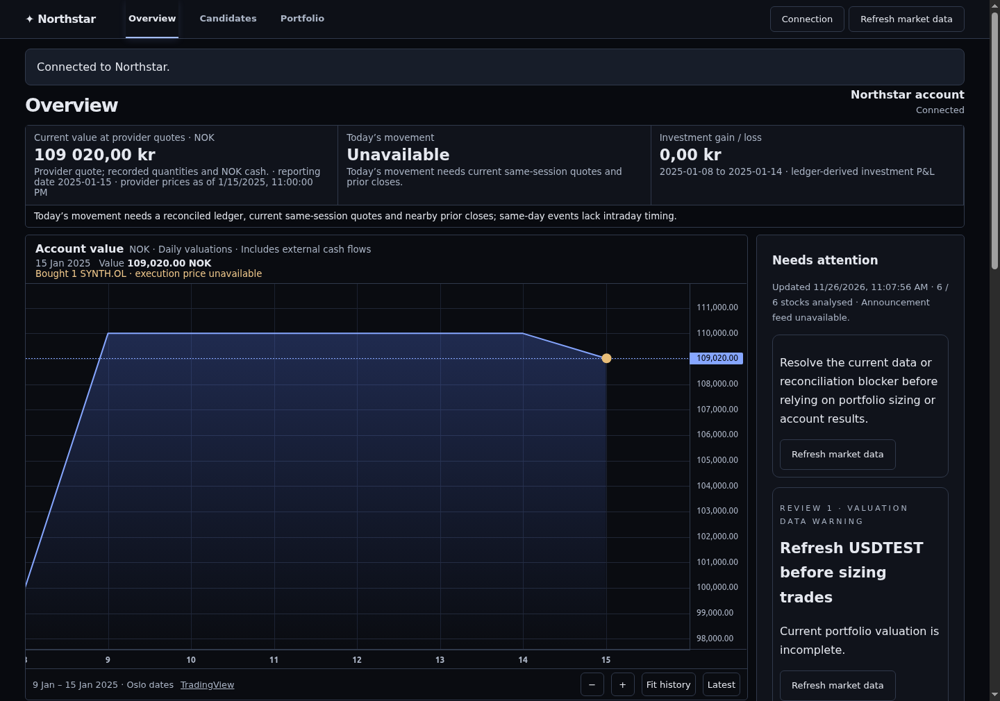
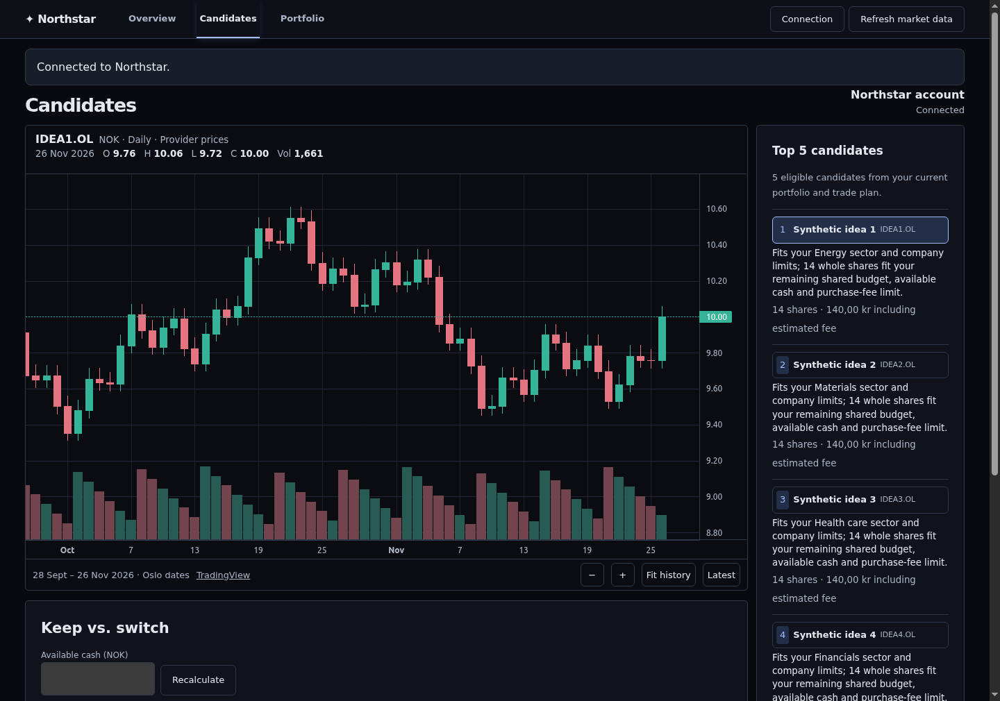

# Northstar

Northstar is a personal dashboard for researching Oslo-listed stocks, tracking a
portfolio and its cash flows, and reviewing ranked buying candidates. It also
supports historical strategy experiments and optional local AI briefings.

## Inside Northstar

**Overview** shows how account value changes over time alongside recorded portfolio activity.



**Candidates** shows ranked buying ideas with interactive price and volume charts.



Both screenshots use synthetic data.

## Run locally

Use Python 3.10+ and a browser. Internet access is needed for fresh market data.

```bash
git clone https://github.com/AugustLind/northstar.git
cd northstar
python3 app.py
```

Open [http://127.0.0.1:8000](http://127.0.0.1:8000). The first research refresh runs in
the background. Portfolio records and cached data live in `data/portfolio.db`.

## Documentation

[Technical reference](docs/REFERENCE.md) · [Strategy mathematics](docs/MATHEMATICS.md) ·
[Local services](docs/LOCAL-SERVICES.md) · [Deployment](docs/deployment/GITHUB-DEPLOY.md) ·
[Recovery](docs/RECOVERY.md) · [Development and checks](docs/DEVELOPMENT.md) ·
[Contributing](CONTRIBUTING.md)
